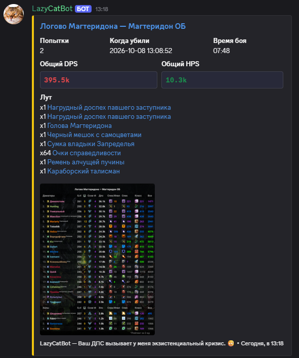
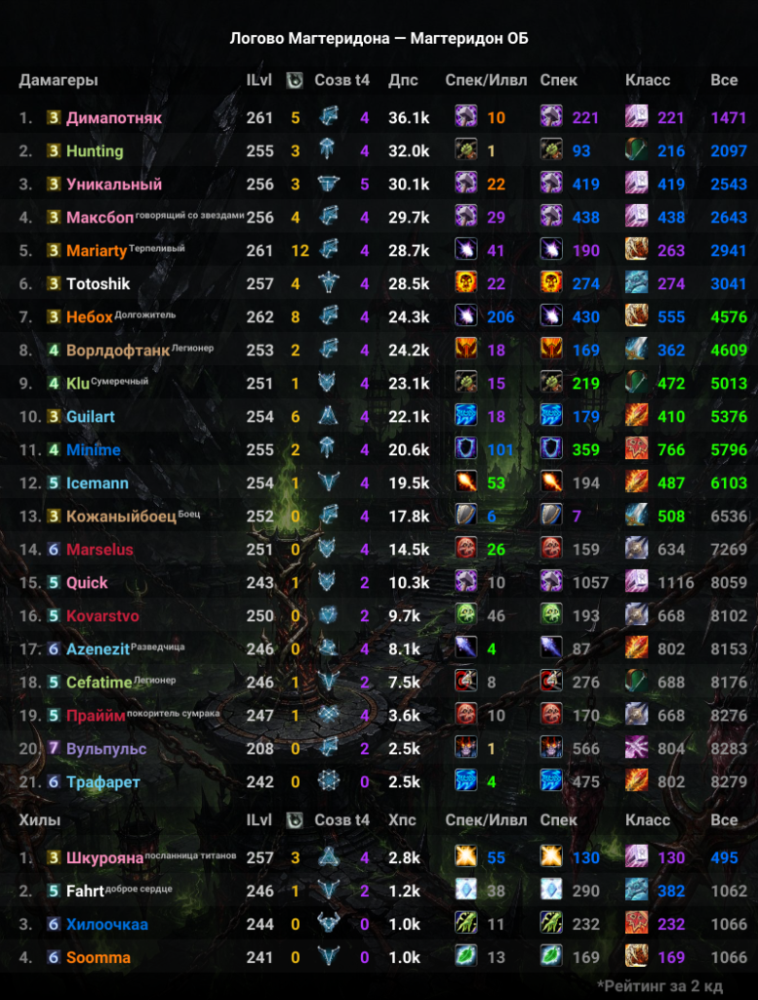
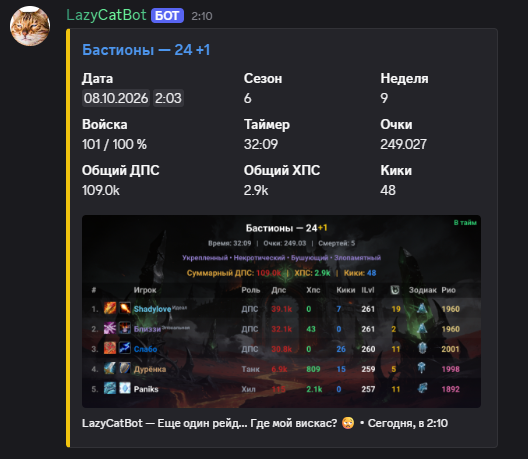
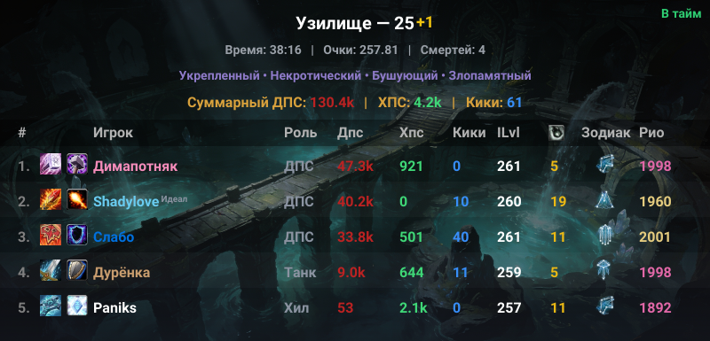

# 🐈 LazyCatBot

Дискорд-бот для отслеживания новых убийств боссов вашей гильдией, рейтингов игроков, посещаемости и мифик-ключей. Присылает красивые отчёты сразу после боя, формирует топы по DPS/HPS, а раз в неделю — итоговый дайджест картинкой.

---

## 🚀 Как добавить и настроить

### 1. Добавление бота
Перейдите по ссылке и выберите нужный сервер:

👉 **[ДОБАВИТЬ LAZYCATBOT НА СЕРВЕР](https://discord.com/oauth2/authorize?client_id=1493704685297602731&permissions=277092879552&integration_type=0&scope=bot+applications.commands)**

> **Важно:** боту нужны права на **чтение сообщений**, **отправку сообщений** и **вставку ссылок (Embed Links)**.

### 2. Настройка канала
1. Создайте текстовый канал (например, `#raid-alerts`) и выдайте боту права на чтение и отправку сообщений в него.
2. В этом канале введите `/menu` — откроется меню с кнопками.
3. Нажмите **«🏰 Добавить гильдию»**, выберите сервер и введите ID гильдии. Аналогично можно добавить игрока через **«👤 Добавить игрока»**.
4. Бот сразу начнёт мониторинг. Если отчёт отправился — всё работает, можно в `/menu` отключить лишние типы отчётов.

> **ID гильдии** — число в конце ссылки на страницу гильдии на [sirus.su](https://sirus.su). Например, в `sirus.su/base/guilds/x3/913` ID — `913`.

---

## ✨ Возможности

### 📊 Отчёты об убийствах боссов
Бот присылает детальный отчёт сразу после убийства босса: время, сложность и основные данные боя.

### 🏆 Рейтинги игроков
Для каждого сражения формируются топы игроков гильдии по **DPS** и **HPS**.

### 🔑 Мифик-отчёты
Отслеживание мифик-подземелий с подробным отчётом о прохождении.

### 🎖 Мифик-рейтинг (Рио)
Команда `/topm` показывает мифик-рейтинг (Рио) среди участников гильдии. Кнопки можно закрепить в канале — они доступны всем.

### 🗓 Посещаемость гильдии
Команда `/attendance` строит картинку с явкой игроков за последние 4 КД: килы, процент посещаемости, класс, спек, роль, илвл и последний кил. В зачёт идут только рейды в режиме на 25 игроков — 10-плейные заходы не искажают статистику.

### 📈 Еженедельный дайджест
Раз в неделю премиум-каналы автоматически получают итоговую картинку: топ DPS/HPS, мифик-топ (рейтинг и высший ключ) и посещаемость за неделю в две колонки. Ту же картинку можно запросить в любой момент командой `/digest`.

### 👤 Профиль игрока
Команда `/profile` показывает карточку персонажа по истории киллов: класс, спек, роль, илвл, сет Т4, лучшие DPS/HPS, Рио, ЧБ, титул и процент посещаемости. Ник подставляется автокомплитом из игроков гильдии.

### 🎛 Панель быстрых действий
Команда `/panel` открывает кнопки для самых частых действий: дайджест, посещаемость, топы по боссам, мифик-рейтинг и премиум.

---

## 🛠️ Команды бота

| Команда | Описание |
| :--- | :--- |
| `/menu` | Меню настройки трекинга и автоматических отчётов (требует права «Управление каналами») |
| `/panel` | Панель с кнопками быстрых действий: дайджест, посещаемость, топы, мифик, премиум |
| `/top` | Меню отправки рейтингов по боссам среди игроков гильдии |
| `/topm` | Мифик-рейтинг (Рио) среди участников гильдии |
| `/attendance` | Посещаемость гильдии за 4 КД картинкой (премиум) |
| `/digest` | Еженедельный дайджест гильдии картинкой (премиум) |
| `/profile` | Профиль игрока по киллам и рейдам (премиум), параметр `name` |
| `/premium` | Премиум для всего сервера: статус, активация и инструкция |
| `/list` | Список отслеживаемых гильдий в текущем канале |
| `/listcats` | Список отслеживаемых игроков в текущем канале |
| `/removechannel` | Полностью удалить канал из отслеживания (требует права «Управление каналами») |
| `/help` | Справка по боту |

Больше команд можно посмотреть прямо в боте — введите `/` в канале, куда добавлен бот.

---

## 💎 Премиум

Премиум оформляется один раз на весь Discord-сервер и стоит **$1/мес**. Он открывает во всех каналах сервера:

- отчёты без очереди в пик рейдов;
- рейтинги за 4 КД и за всё время;
- еженедельный дайджест картинкой (автоматически и по `/digest`);
- посещаемость гильдии за 4 КД только по рейдам на 25 игроков;
- профили игроков с Рио, ЧБ, титулами и Т4;
- без лимитов на гильдии, реалмы и игроков.

Оформление: введите `/premium` в любом канале сервера, получите код и оформите подписку по ссылке. Кнопка «🐾 Премиум» также есть в `/menu` и `/panel`.
Премиум действует на весь сервер: остальные каналы тоже становятся премиальными, отдельно платить не нужно.

---

## ❓ Часто задаваемые вопросы

**Где взять ID гильдии?**
Зайдите на сайт [Sirus.su](https://sirus.su), найдите гильдию в базе и возьмите число из конца ссылки. В `sirus.su/base/guild/x3/1234` ID — `1234`.

**Где посмотреть дайджест и посещаемость?**
Используйте `/digest` и `/attendance` в канале, где отслеживается гильдия, либо откройте `/panel` и нажмите нужную кнопку. Обе команды доступны с премиумом.

**Почему рейды на 10 игроков не попадают в посещаемость?**
Посещаемость считается только по актуальным рейдам в режиме на 25 игроков, чтобы заходы в 10-плейные сложности не занижали и не искажали явку основного состава.

**Бот не присылает отчёты — что делать?**
1. Проверьте, что у бота есть права на **просмотр канала** и **отправку сообщений (Embed)**.
2. Проверьте, что отчёты включены в `/menu` — там должно быть **«Мифик: ВКЛ»** / отчёты «ВКЛЮЧЕНЫ».
3. Если бот потерял доступ к каналу, он уведомит об этом и сам удалит неактивную подписку.

---

## 📄 Лицензия

Проект распространяется по лицензии [MIT](LICENSE).